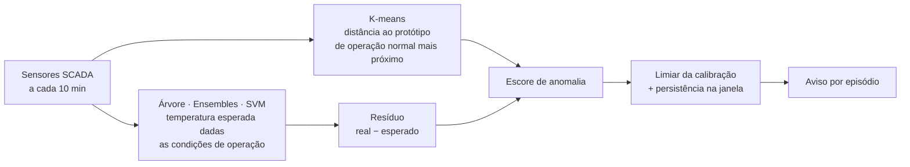

# 🌬️ EoloSense

**Detecção precoce de falhas em turbinas eólicas a partir dos sensores SCADA, para evitar paradas não programadas da geração.**

Projeto final da disciplina de **Machine Learning Clássico** · Engenharia de Computação · Centro Universitário UniSATC · 2026 · Prof. Dr. Rodrigo Ramos Silva

---

## Sumário

1. [O problema](#1-o-problema)
2. [O que o projeto entrega (e o que não promete)](#2-o-que-o-projeto-entrega-e-o-que-não-promete)
3. [Dados](#3-dados)
4. [Modelos](#4-modelos)
5. [Protocolo comum de avaliação](#5-protocolo-comum-de-avaliação)
6. [Resultados](#6-resultados)
7. [Como reproduzir](#7-como-reproduzir)
8. [Estrutura do repositório](#8-estrutura-do-repositório)
9. [Limitações](#9-limitações)
10. [Equipe e referências](#10-equipe-e-referências)

---

## 1. O problema

Uma turbina parada por falha deixa de gerar energia durante o diagnóstico, a compra da peça e o reparo. Em componentes grandes, como caixa multiplicadora e gerador, isso pode durar semanas. Toda turbina moderna já registra dezenas de sensores a cada 10 minutos no sistema **SCADA** (temperaturas, rotação, potência, vento). O EoloSense usa esses dados para **avisar que o comportamento da máquina mudou antes da falha**, quando ainda dá para planejar a manutenção.

| Estratégia de manutenção | Como funciona | Limitação |
| --- | --- | --- |
| Corretiva | Conserta depois que quebra | Parada longa e não planejada |
| Preventiva | Troca em intervalos fixos | Troca peça boa e não pega falha fora do intervalo |
| **Preditiva (este projeto)** | Monitora os sensores e age quando o comportamento muda | Precisa de um modelo do que é "normal" |

## 2. O que o projeto entrega (e o que não promete)

✅ **Entrega:** detecção de **anomalias que antecedem falhas**. A turbina é comparada com o seu próprio comportamento normal, e um aviso é emitido quando o desvio é persistente. Cada aviso indica qual sensor mais desviou.

❌ **Não promete:** prever a data exata da quebra (vida útil remanescente). Os dados rotulam uma janela de anomalia antes da falha, não uma contagem regressiva.

## 3. Dados

**[CARE to Compare v6](https://zenodo.org/records/15846963)** (Fraunhofer IEE, licença CC BY-SA 4.0), publicado com o artigo [*CARE to Compare: A real-world dataset for anomaly detection in wind turbine data*](https://doi.org/10.3390/data9120138).

| | Fazenda A | Fazenda B | Fazenda C | Total |
| --- | --- | --- | --- | --- |
| Origem | EDP, onshore, Portugal | Offshore, Alemanha (anonimizada) | Offshore, Alemanha (anonimizada) | |
| Eventos | 22 (12 com anomalia) | 15 (6 com anomalia) | 58 (27 com anomalia) | **95** (45 com anomalia, 50 normais) |
| Resolução | 10 min | 10 min | 10 min | |

Cada evento é um CSV de uma turbina com uma **seção de treino** (histórico) e uma **seção de previsão** (onde pode estar a anomalia), além de `status_type_id` (estado operacional) e de uma janela anotada em `event_info.csv`. Usamos apenas as médias (`_avg`), sem ângulos e contadores, como recomendam os autores.

Download e conferência (os dados brutos não entram no Git):

```bash
mkdir -p data
curl -L -C - --retry 8 -o data/CARE_To_Compare.zip \
  'https://zenodo.org/records/15846963/files/CARE_To_Compare.zip?download=1'
md5sum data/CARE_To_Compare.zip    # esperado: 2547b58c21ac8c242d13232860cf500c
unzip data/CARE_To_Compare.zip -d data/CARE_To_Compare
```

No Windows, use `curl.exe --ssl-no-revoke` no lugar de `curl`. As pastas devem ficar em `data/CARE_To_Compare/Wind Farm A`, `Wind Farm B` e `Wind Farm C`.

## 4. Modelos

Quatro famílias, com duas formas de definir "normal":



| Modelo | Abordagem | Documentação |
| --- | --- | --- |
| **K-means** | Não supervisionado: agrupa a operação normal em protótipos; o escore é a distância ao protótipo mais próximo | [K-means/DETECCAO_E_ALERTAS.md](K-means/DETECCAO_E_ALERTAS.md) · [histórico dos experimentos](K-means/README.md) |
| **Árvore de Decisão** | Comportamento normal: prevê as temperaturas dos componentes a partir de vento, potência, rotação e temperatura ambiente; poda por `ccp_alpha` | [Arvore-de-Decisao/README.md](Arvore-de-Decisao/README.md) |
| **Ensembles** | Idem, com Random Forest, Extra Trees e Gradient Boosting competindo por evento | [Ensembles/README.md](Ensembles/README.md) |
| **SVM** | Idem, com SVR de kernel RBF | [SVM/README.md](SVM/README.md) |
| *Regressão Linear* | Referência mínima para os supervisionados (Ridge) | [Regressao-Linear/README.md](Regressao-Linear/README.md) |

Detalhes dos modelos supervisionados (escolha de entradas e alvos, médias móveis de carga, escore pelo maior resíduo suavizado): [Comum/README.md](Comum/README.md).

## 5. Protocolo comum de avaliação

Todos os modelos seguem as mesmas regras, então os números são comparáveis:

1. **Um modelo por evento**, treinado só com a seção de treino em operação normal (`status_type_id = 0`).
2. **Divisão cronológica** dentro do treino normal: ajuste, 1 dia de intervalo e calibração (últimos 20%). O limiar é um percentil do escore na calibração.
3. **Partição por turbina**: 30% das turbinas de cada fazenda, por hash SHA-256 com semente 42. Resultado: **65 eventos de desenvolvimento** e **30 reservados**. Eventos da mesma turbina nunca ficam dos dois lados.
4. **Regra de alerta** (percentil × janela × fração de excedências) escolhida só no desenvolvimento, com orçamento de **até 5 avisos falsos por 30 dias** e **até 25% do tempo em incidente** em trechos normais. Ela é congelada antes de abrir os reservados.
5. **Avisos por episódio**: um aviso quando o alarme começa; novo aviso só depois de 6 h de recuperação.
6. **Métricas por evento**: *sensibilidade* (falha com aviso novo dentro da janela anotada), *especificidade* (evento normal sem nenhum aviso), precisão e avisos falsos por 30 dias. Os supervisionados também reportam MAE, RMSE e R² da regressão em dados normais não vistos.

Critério experimental definido pelo grupo para aceitar um detector: **sensibilidade ≥ 70% e especificidade ≥ 80%**.

## 6. Resultados

**K-means (dados reais, 30 eventos reservados, perfil principal P95 / 6 h / 25%)**, conforme [DETECCAO_E_ALERTAS.md](K-means/DETECCAO_E_ALERTAS.md):

| Medida | Valor |
| --- | ---: |
| Falhas com aviso novo dentro da janela | 9/15 (60,0%) |
| Falhas com sinal de alarme na janela | 11/15 (73,3%) |
| Eventos normais com algum aviso | 14/15 |
| Precisão por evento | 39,1% |
| Avisos falsos por 30 dias normais | 5,03 |

O K-means detecta boa parte das falhas, mas avisa em quase todos os eventos normais e não atinge o critério de aceite. Isso motivou os modelos de comportamento normal, que comparam cada sensor com o valor esperado para as condições do momento, em vez de comparar a turbina inteira com protótipos.

**Árvore de Decisão, Ensembles e SVM:** o código está pronto e testado, e a execução nos 95 eventos reais está em andamento. Ao terminar, a comparação completa (incluindo o K-means) fica em `Comum/outputs/principal/COMPARACAO.md` e `comparacao.png`, e cada modelo ganha seu `RESULTADOS.md`. Para explorar evento a evento, use o painel:

```bash
./.venv/Scripts/python.exe -m streamlit run app_streamlit.py
```

O painel tem três abas: **Comparação** (métricas dos modelos frente ao critério de aceite), **Evento a evento** (escore, limiar, janela anotada, avisos e sensor que mais desviou) e **Como o modelo decide** (refaz a previsão de um instante real e confere com o `predict()`; na árvore, mostra o caminho de decisões até a folha).

## 7. Como reproduzir

### Opção 1: Google Colab (sem instalar nada)

Abra [EoloSense_Colab.ipynb](EoloSense_Colab.ipynb) no Colab. O notebook clona o repositório, baixa e confere o CARE, roda os testes, treina os modelos supervisionados (por padrão só a fazenda A) e mostra os resultados.

### Opção 2: máquina local

Requer Python 3.10 ou superior. Comandos para Git Bash no Windows, na raiz do projeto (no Linux/macOS, troque `./.venv/Scripts/python.exe` por `./.venv/bin/python`):

```bash
python -m venv .venv
./.venv/Scripts/python.exe -m pip install -r requirements-app.txt   # inclui o painel
```

```bash
# 1. Testes automatizados (não precisam do dataset)
./.venv/Scripts/python.exe -m unittest discover -s K-means/tests -v
./.venv/Scripts/python.exe -m unittest discover -s Comum/tests -v

# 2. K-means: avaliação base, depois seleção do perfil principal
./.venv/Scripts/python.exe K-means/src/tuning_search.py
./.venv/Scripts/python.exe K-means/src/evaluate_failure_alerts.py
./.venv/Scripts/python.exe K-means/src/tune_detection.py --max-false-per-30-days 5 --output-dir K-means/outputs/detection_balanced

# 3. Árvore, Ensembles, SVM e Regressão Linear (retomável; ajuste --jobs aos núcleos livres)
./.venv/Scripts/python.exe Comum/src/treinar_modelos.py --jobs 4

# 4. Painel
./.venv/Scripts/python.exe -m streamlit run app_streamlit.py
```

O passo 3 leva algumas horas com as três fazendas; `--farms A` roda só a fazenda A para conferir antes. Se os modelos forem treinados em comandos separados, `--compare-only` refaz a comparação com tudo o que já existe.

## 8. Estrutura do repositório

```
├── README.md                 este arquivo
├── EoloSense_Colab.ipynb     reprodução no Google Colab
├── app_streamlit.py          painel de resultados
├── requirements.txt          dependências do treino
├── requirements-app.txt      + Streamlit e Plotly para o painel
├── data/                     CARE extraído (fora do Git)
├── K-means/                  modelo não supervisionado, experimentos e decisão documentada
│   ├── src/                  treino, alertas, episódios, busca de configurações
│   └── tests/
├── Comum/                    núcleo dos modelos supervisionados
│   ├── src/nbm.py            entradas, alvos, divisão temporal, grades, poda, escore
│   ├── src/treinar_modelos.py  treino paralelo, seleção da regra, avaliação, relatórios
│   └── tests/                dataset sintético no formato CARE e testes do método
├── Arvore-de-Decisao/        README do modelo + outputs/
├── Ensembles/                README do modelo + outputs/
├── SVM/                      README do modelo + outputs/
└── Regressao-Linear/         README do baseline + outputs/
```

Cada pasta `outputs/<execução>/` (fora do Git) contém `RESULTADOS.md`, `metrics.csv`, `events.csv`, `regression.csv`, a regra congelada, figuras e, por evento, o modelo treinado (`model.joblib`), as previsões e um `report.json` com alvos, entradas, grade testada e importâncias.

## 9. Limitações

- Os 30 eventos reservados já foram consultados nos experimentos do K-means: é avaliação interna reutilizada, não teste externo intocado. Nenhuma escolha dos modelos supervisionados usou esses eventos.
- Eventos da mesma turbina são correlacionados; 95 eventos não são 95 ensaios independentes.
- Os timestamps do CARE são anonimizados por arquivo; não se junta a cronologia entre eventos.
- As métricas são por evento e simplificadas; não implementam o CARE score oficial.
- Na fazenda A, o `status_type_id` deriva do logbook de falhas, por isso não é usado para filtrar a previsão (orientação dos autores).
- O SVR treina numa amostra de 3.000 linhas por evento, por custo computacional.

## 10. Equipe e referências

**Equipe:** Miguel Firme · Lorenzo Viero Sartori · João Gustavo

**Referências**

- GÜCK, C.; ROELOFS, C. M. A.; FAULSTICH, S. CARE to Compare: A real-world dataset for anomaly detection in wind turbine data. *Data*, v. 9, n. 12, 138, 2024. DOI: [10.3390/data9120138](https://doi.org/10.3390/data9120138).
- GÜCK, C.; ROELOFS, C. Wind Turbine SCADA Data For Early Fault Detection (v6). Zenodo, 2025. DOI: [10.5281/zenodo.15846963](https://doi.org/10.5281/zenodo.15846963).
- Fraunhofer IEE. [CARE to Compare: FAQ](https://aefdi.github.io/EnergyFaultDetector/care2compare_faq.html) (janelas de anomalia e status da fazenda A).
- PEDREGOSA, F. et al. Scikit-learn: Machine Learning in Python. *Journal of Machine Learning Research*, v. 12, p. 2825–2830, 2011.
- SILVA, R. R. Guias práticos da disciplina: Árvores de Decisão, Ensemble Learning e Clustering com K-means. UniSATC, 2026.
